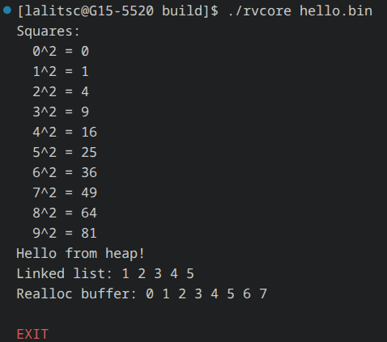

# rvcore: A Tiny RISC-V Emulator That Runs DOOM



<div align="center">
  DOOM running in rvcore | <a href="https://youtu.be/f5uygzEmdLw?si=Q32DF_eGzetCb8SE">Video demo</a>
</div>
<br/>

`rvcore` is a RISC-V emulator that provides a minimal runtime environment for running DOOM and other bare-metal C/C++ programs. It implements the RV32IM ISA, except for the `FENCE` and `EBREAK` instructions.

## How it works

DOOM runs as a baremetal program, with the syscalls intercepted and emulated by `rvcore`.

DOOM renders directly to a memory-mapped framebuffer and keyboard input is delivered through a small ring buffer shared with the emulator.

```
0x7FFFFF  +-------------------------------------+
          |                                     |
          |        QUEUE_SIZE (32 bytes)        |
          |                                     |
0x7FFFDF  +-------------------------------------+ <-- QUEUE_START
0x7FFFDE  |          QUEUE_READ_IDX             |
0x7FFFDD  |          QUEUE_WRITE_IDX            |
          +-------------------------------------+
          |                                     |
          |                                     |
          |       VRAM (1,024,000 bytes)        |
          |                                     |
          |                                     |
0x705FDD  +-------------------------------------+ <-- VRAM_START / STACK_START
          |                Stack                |
          |                  |                  |
          |                  v                  |
          |                                     |
          |                  ^                  |
          |                  |                  |
          |         Program data + Heap         |
          |                                     |
0x000000  +-------------------------------------+
```

## Milestones

- [x] Run flat binaries written in assembly

- [x] Run flat binaries written in C

- [x] Load ELF binaries (binaries with a single `PT_LOAD` segment work)

- [x] Implement the `newlib` stubs needed to run DOOM

- [x] Get DOOM to boot

- [x] Make DOOM playable

- [x] Implement the M extension

## Building

Instructions are provided in [BUILD.md](BUILD.md).

## Running bare-metal programs

Navigate to the `examples` directory to see how to run simple C programs on `rvcore`. Only a few essential newlib stubs are implemented.

To implement a new stub, first modify `stubs.h` and then add the appropriate handler in `cpu.cpp`.
